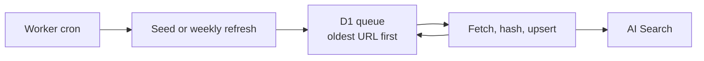
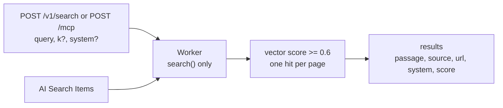

# Architecture

Cited retrieval over indexed design-system docs. The worker returns stored passages. It does not write them.

## Seed to queue to index



Seed ids: `paste`, `primer`, `uswds`, `govuk`, `nhs`, `antd`, `gitlab-pajamas`, `patternfly`, `cloudscape`, `vanilla`, `siemens-ix`, `backpack`, `garden`, `ouds-web`. One `startUrl` each.

The cron reads `queue` (`url`, `system_id`, `enqueued_at`, `op`). `url` is unique. Seeding a system appends its root as a page fetch and its robots and sitemap URLs as sitemap rows. It does not fetch them. A weekly refresh runs when `system_mark.last_discovered` is at least 7 days old. It appends those sitemap rows and every known page URL in one insert. It does not fetch those pages, and a URL missing from the sitemap is not deleted. A gone page is removed because that weekly refresh enqueues every known page and the consumer deletes the stored page on 404 or 410. The worker then takes the oldest rows, up to the existing drain batch, and stops at the tick deadline. A sitemap row is fetched once, and its child sitemaps and page URLs are appended to the back, so a sitemap that spans ticks continues from the queue. An unchanged hash removes the row only after any older copy of that page is gone, and it does not upload. A new or changed page is uploaded, which chunks and embeds it, and the row stays until those older copies are deleted. A failed fetch or a failed delete updates `enqueued_at` and `error` so the row sits at the back. While a page is fetched, links that are not already stored or queued are appended with the same insert.

The tick log `index_queue` reports `depth` and `oldestAgeMs`.

The cron does not start `ReindexWorkflow`. That class is gone. `discover_run` is not read by the cron.

`GET /v1/index-status` returns the last-run JSON plus queue depths (`pending`, `claimed`, `failed`, `done`) and per-system `lastCrawled`, `lastIndexed`, and `lastDiscovered`. `discover` is `null`, or `{ systemId, jobId, kind, trigger, startedAt }` read from the live D1 `discover_run` row on that request. It is not copied onto the KV status document. `GET /status` renders the rollup and per-seed rows from that same read. Unparked ids and the crawl/render/index error lists stay on the JSON document. Both routes require the Worker secret `STATUS_TOKEN` via `Authorization: Bearer` or `?token=`. A missing or wrong token is `401`. Set it with `bunx wrangler secret put STATUS_TOKEN` and do not commit the value. `/health`, `/v1/search`, and `/mcp` stay public. The HTML page is server-rendered markup and CSS, with no client script. A browser refresh is a new GET. It has no queue, reindex, or park controls. `/status`, `/v1/index-status`, and `/v1/fill-health` require `STATUS_TOKEN`. `GET /v1/fill-health` reports queue depth and the age of the oldest row. `bun run reindex` stays debug-only.

## Query to citation JSON



`query` required. `k` is optional, max 50. Omit it to return every passage at or above 0.6, up to 50. A set `k` only shortens that list. `system` optional, a seed id. `POST /mcp` is Streamable HTTP MCP on the same worker. `@modelcontextprotocol/server` `createMcpHandler` owns the JSON-RPC envelope. `tools/call` for `search_design_guidance` uses the same parse and `searchCitations` path as `/v1/search`. It does not loop back over HTTP. Install steps for Cursor, Claude Code, and Codex live in the [root README](../README.md).

```json
{ "results": [{ "passage": "…", "source": "Primer", "url": "https://…", "system": "primer", "score": 0.72 }] }
```

`passage` is the chunk text, verbatim. `url` is the page https URL. `source` is the label. `system` is the seed id. `score` is the AI Search vector similarity score (`scoring_details.vector_score`). The 0.6 floor uses that same score. The worker asks AI Search for the top 50 chunks by vector similarity (`retrieval_type: "vector"`) and sends `reranking: { enabled: false }`. It drops `llms.txt` index files, keeps the highest-scoring chunk of each page, and sorts by similarity, highest first. A page under 0.6 is never returned. The calling agent decides relevance.

No matches after the filter: `{ "results": [] }`. Missing query: `400` `{ "error": "query_required" }`.

The query path calls `search()` only. No rewrite. No chat completions.

The golden query is `accessible combobox or listbox keyboard and focus guidance`. A pass is HTTP 200 with at least two distinct `system` values. Each hit has `passage`, `source`, `url`, and `score` of 0.6 or greater. A human spot-check confirms the passages are about combobox or listbox keyboard and focus accessibility.

`GET /health` is `200` when the index is ready. `GET /v1/index-status` is last-run health plus the live page queue: depths, per-system `lastCrawled` / `lastIndexed` / `lastDiscovered`, parks, unparked ids, crawl/render/index errors, and `discover` from the open D1 discover run. `GET /status` is the HTML view of that read: rollup, queue depths, discover, and one row per seed with phase, depths, those timestamps, park text, and a system error when the stored result still has one. `GET /v1/fill-health` reads that same overlay once and returns `{ "fill": "ok" | "alarm", "alarms", "checkedAt" }`. A healthy body includes the exact substring `"fill":"ok"`. An alarm stays HTTP 200 and omits that substring. `fleet_freeze` is no discover, nothing pending or claimed, and a seed that is Empty or seed-drift eligible and outside the scheduler cap-defer backoff (`cap_defer` streak: 1 hour, 6 hours, 1 day, then 7 days). Parked seeds, Live seeds, and seeds waiting out that backoff do not count. `stuck:<systemId>` is that seed's `failed > 0` with nothing pending or claimed. `pending_no_claims:<systemId>` is a Filling seed with pending pages, no claim, and no done pages while another seed has a claim. `hard_fail` is global state `fail`, a run error from discover, or a non-Parked seed whose current result still has an error and an idle queue. An incomplete crawl is not that error. `incomplete`, a stored `hitLimit`, or a stored `crawl hit the <n> page limit` note paints the row Incomplete, with `incomplete: <pages> pages, ceiling 10000`. It does not alarm `hard_fail`. Mid-fill alone, Parked stubs, and Live idle do not alarm. The route uses the same `STATUS_TOKEN` gate and does not write the queue, parks, or status. The HTML page does not list unparked ids or the crawl/render/index channel breakdown. `/status`, `/v1/index-status`, and `/v1/fill-health` require `STATUS_TOKEN`. Email names `GET /status` and how to send `STATUS_TOKEN`. It does not include the secret or a link to `/v1/index-status`. Email is a push of start, finish, and stuck summaries, not a replacement for the pull endpoint. Mid-fill does not fail the status or the mail. A queue with `failed > 0` and nothing pending or claimed is stuck. Pending or claimed pages are mid-fill. A stored `result.error` other than that cap note is the current failure: older `done` or `lastIndexed` values do not paint that row Live, and the error stays visible. When that error is gone, an idle queue with `done` or `lastIndexed` and no park or failed rows is live.
